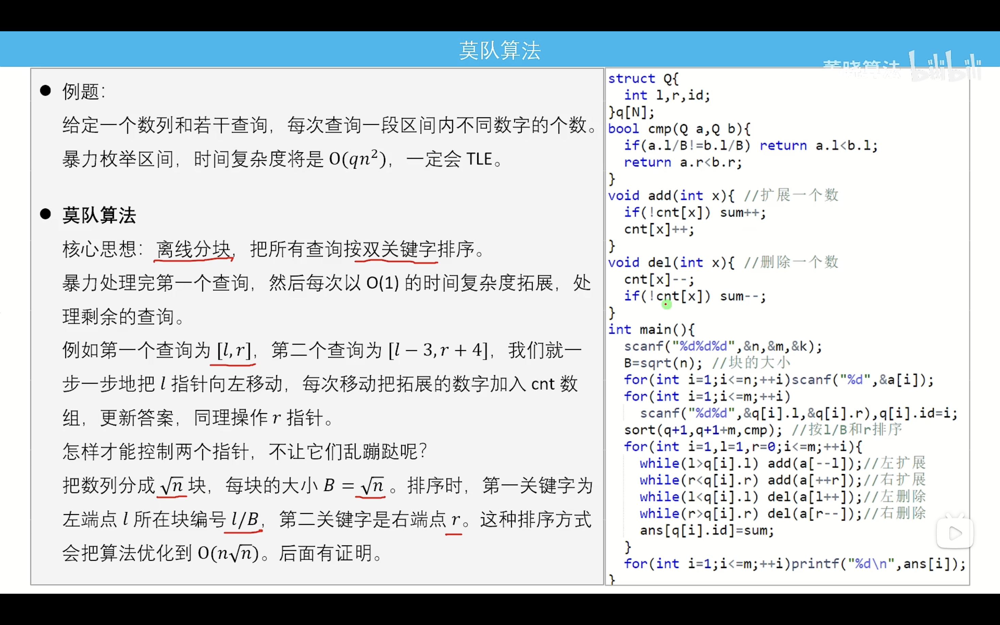
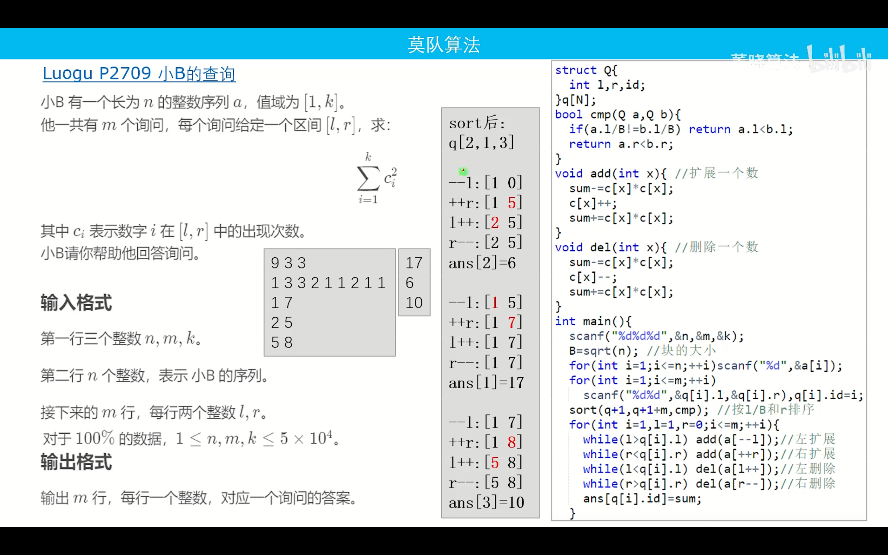

# 莫队算法 (Mo's Algorithm)



 

## 一、本质与定位

莫队算法不是一种「数据结构」，而是一种**离线询问处理技巧**。它的核心思想是：

> **通过将询问按特定顺序排序，使得暴力维护窗口 $[L, R]$ 的指针总移动量从 $O(nq)$ 降为 $O(n\sqrt{q})$。**

- **分类**：根号算法 / 平方分割思想
- **适用条件**：离线询问 + 可以从相邻区间 $O(1)$ 或 $O(\log n)$ 转移
- **核心操作**：`add(x)` 和 `del(x)` — 在区间中加入/删除位置 $x$ 的元素

---

## 二、普通莫队

### 2.1 基本流程

1. 将所有询问 $[l_i, r_i]$ 离线存储
2. 按 `(l / B, r)` 排序（$B$ 为块大小，通常取 $\sqrt{n}$ 或 $\frac{n}{\sqrt{q}}$）
3. 维护当前区间 $[L, R]$，暴力移动 $L$ 和 $R$ 指针以匹配每个询问

### 2.2 块大小分析

| 场景            | 块大小                       | 说明               |
| --------------- | ---------------------------- | ------------------ |
| $n \approx q$ | $B = \sqrt{n} \approx 316$ | 最通用             |
| $q \ll n$     | $B = \frac{n}{\sqrt{q}}$   | 更精细的最优值     |
| 带修改莫队      | $B = n^{2/3}$              | 三维情况的最优分块 |

**复杂度**：$O(n\sqrt{q})$ 次指针移动，每次 $O(f)$ 转移 → $O(n\sqrt{q} \cdot f)$

### 2.3 模板代码

```cpp
const int N = 1e5 + 9, B = 316; // B = sqrt(n)

struct Query {
    int l, r, id;
};

int n, m, a[N], cnt[N], cur_ans;
vector<Query> qs;
int ans[N];

void add(int pos) {
    int x = a[pos];
    // 根据题目具体维护
    cnt[x]++;
    // 更新 cur_ans
}

void del(int pos) {
    int x = a[pos];
    cnt[x]--;
    // 更新 cur_ans
}

void solve() {
    // 读入 n, m, a[1..n]
    qs.resize(m);
    for (int i = 0; i < m; i++) {
        cin >> qs[i].l >> qs[i].r;
        qs[i].id = i;
    }

    // 排序：奇偶优化
    sort(qs.begin(), qs.end(), [](const Query &a, const Query &b) {
        if (a.l / B != b.l / B) return a.l < b.l;
        // 奇数块 r 降序，偶数块 r 升序（减少 R 指针回扫）
        return (a.l / B) & 1 ? a.r > b.r : a.r < b.r;
    });

    int L = 1, R = 0;
    for (auto &q : qs) {
        // 先扩展再收缩，避免 L > R 的非法状态
        while (L > q.l) add(--L);
        while (R < q.r) add(++R);
        while (L < q.l) del(L++);
        while (R > q.r) del(R--);
        ans[q.id] = cur_ans;
    }

    for (int i = 0; i < m; i++) cout << ans[i] << '\n';
}
```

### 2.4 奇偶排序优化

```
块 0: l/ B = 0 → r 升序
块 1: l/ B = 1 → r 降序  ← 处理完块 0 后 R 在末尾，降序避免了 R 的长距离回扫
块 2: l/ B = 2 → r 升序
...
```

实测可提速 **30% ~ 50%**。

### 2.5 指针移动顺序

```
while (L > q.l) add(--L);  // 左扩
while (R < q.r) add(++R);  // 右扩
while (L < q.l) del(L++);  // 左缩
while (R > q.r) del(R--);  // 右缩
```

> ⚠️ **必须先扩后缩**。否则在 `L > R` 的非法状态下 `del` 会导致错误。

---

## 三、带修改莫队（带时间轴莫队）

### 3.1 问题形式

询问 $[l, r]$，中间穿插**修改操作**（改变某位置的值为新值）。

### 3.2 三维莫队

将询问扩展为三维：$(l, r, t)$，其中 $t$ 表示该询问之前发生过多少次修改。

- 排序：按 `(l/B, r/B, t)` 排序
- 指针移动：$L$、$R$、$T$（时间指针）各自移动
- 块大小：$B = n^{2/3}$（三维的分块最优值）
- 复杂度：$O(n^{5/3})$ 约 $O(n^{1.67})$

### 3.3 模板代码

```cpp
const int B = 2154; // n^(2/3), 对 n=1e5 约为 2154

struct Query {
    int l, r, t, id; // t: 该询问之前有多少次修改
};

struct Modify {
    int pos, old_val, new_val;
};

int L = 1, R = 0, T = 0;

void apply_modify(int t, int L, int R) {
    // 执行或撤销第 t 次修改
    // 如果修改位置在当前区间内，需要更新答案
}

void solve() {
    sort(qs.begin(), qs.end(), [](const Query &a, const Query &b) {
        if (a.l / B != b.l / B) return a.l < b.l;
        if (a.r / B != b.r / B) return (a.l / B) & 1 ? a.r > b.r : a.r < b.r;
        return ((a.r / B) & 1) ? a.t > b.t : a.t < b.t; // 第三维也奇偶优化
    });

    for (auto &q : qs) {
        while (L > q.l) add(--L);
        while (R < q.r) add(++R);
        while (L < q.l) del(L++);
        while (R > q.r) del(R--);
        while (T < q.t) apply_modify(++T, L, R);
        while (T > q.t) apply_modify(T--, L, R);
        ans[q.id] = cur_ans;
    }
}
```

---

## 四、回滚莫队（Rollback Mo）

### 4.1 适用场景

当 `del` 操作难以实现（或 `add` 操作难以实现）时使用。

- **只增不删**：$[l, r]$ 同一块内的暴力，不同块的永远向右扩展
- **只删不增**：对称处理

### 4.2 只增不删的流程

1. 按块处理询问，当前块的所有询问的 $l$ 落在同一块内
2. 对于同一块内的询问，$R$ 只向右扩展（不回退），$L$ 每次从块的右边界向左扩展到 $l$
3. 每次询问完后，**回滚** $L$ 的扩展（恢复 `add` 的影响）
4. 同一块内用完，彻底清空 $L$、$R$ 和所有状态

### 4.3 适用问题

- 求区间 $\text{mex}$
- 求区间众数
- 求区间最大出现次数
- 并查集维护的连通性问题

### 4.4 模板骨架

```cpp
for (int block = 0; block <= n / B; block++) {
    int br = min(n, (block + 1) * B - 1); // 当前块右边界
    // 取出所有 l 在当前块内的询问，按 r 升序
    vector<Query> cur;
    for (auto &q : qs)
        if (q.l / B == block) cur.push_back(q);
    sort(cur.begin(), cur.end(), [](auto &a, auto &b) { return a.r < b.r; });

    int R = br, L = br + 1;
    clear_state();
    ll cur_ans = 0;

    for (auto &q : cur) {
        if (q.r <= br) {
            // 询问完全在一个块内：直接暴力
            brute_force(q);
            continue;
        }
        // R 只向右扩展
        while (R < q.r) add(++R);
        // 保存当前状态
        auto snapshot = save_state();
        // L 向左扩展
        while (L > q.l) add(--L);
        ans[q.id] = cur_ans;
        // 回滚 L
        restore_state(snapshot);
        L = br + 1;
    }
}
```

---

## 五、树上莫队

### 5.1 核心思想

将树上的路径询问转化为序列上的区间询问。

### 5.2 欧拉序

对树做 DFS，每个节点在**进入**和**离开**时各记录一次，得到长度为 $2n$ 的欧拉序。

- `in[u]` = 进入 $u$ 的时间戳
- `out[u]` = 离开 $u$ 的时间戳

### 5.3 路径转区间

对于路径 $u \to v$（设 `in[u] < in[v]`）：

- 若 $\text{LCA}(u, v) = u$（直链）：区间 = $[\text{in}[u], \text{in}[v]]$
- 否则：区间 = $[\text{out}[u], \text{in}[v]]$，需额外加入 $\text{LCA}(u, v)$

### 5.4 出现次数处理

在欧拉序区间中，每个节点可能出现 0、1 或 2 次。需要维护一个 `vis` 数组来**翻转**节点的状态：

```cpp
void toggle(int u) {
    if (vis[u]) del(u);  // 第二次出现 → 删除
    else        add(u);  // 第一次出现 → 加入
    vis[u] ^= 1;
}
```

---

## 六、二次离线莫队

### 6.1 动机

普通莫队移动指针时，每次 `add`/`del` 都需要 $O(f)$ 查询。当 $f = O(\log n)$ 时（如 BIT），总复杂度 $O(n\sqrt{q} \log n)$ 可能被卡。二次离线将这些查询**再离线一次**，用扫描线批量处理，去掉 $\log$。

### 6.2 核心思想

莫队移动指针时产生的查询可以分解为「前缀信息」：

- 左指针左移 $L \to l$：需要 $a[L-1..l]$ 每个元素与 $[L, R]$ 的贡献
  可以分解为 $f(R, i) - f(L-1, i)$，其中 $f(p, i)$ 是 $a_i$ 与 $[1, p]$ 的贡献
- 右指针右移 $R \to r$：同理分解

这些 $f(p, i)$ 查询被**记录下来**，然后按 $p$ 排序，用一次扫描线 + BIT 批量处理。

### 6.3 复杂度

- 莫队产生 $O(n\sqrt{q})$ 个二次查询
- 扫描线：$O(n\log n + n\sqrt{q})$
- 总复杂度：**$O(n\log n + n\sqrt{q})$**，去掉了莫队转移里的 $\log$

### 6.4 适用问题

- 区间逆序对
- 区间满足某条件的元素对数
- 任何 $f(l, r, x)$ 可拆分为 $g(1..r, x) - g(1..l-1, x)$ 的问题

---

## 七、常见应用场景

| 问题类型               | 莫队变种                  | 说明                      |
| ---------------------- | ------------------------- | ------------------------- |
| 区间颜色/种类数        | 普通莫队                  | `cnt[x]` 统计出现次数   |
| 区间众数               | 回滚莫队                  | 难以 `del`              |
| 区间 mex               | 回滚莫队                  | 只增不删更好写            |
| 区间逆序对             | 普通莫队 + BIT / 二次离线 | 看数据范围                |
| 区间和/平方和          | 普通莫队                  | 统计量公式可$O(1)$ 更新 |
| 带修改的区间           | 带时间轴莫队              | $B = n^{2/3}$           |
| 树上路径询问           | 树上莫队                  | 欧拉序                    |
| 区间内满足某条件的对数 | 普通莫队 / 二次离线       | 视转移代价                |

---

## 八、常见坑点

1. **块大小**：不是无脑取 `sqrt(n)`。$n=10^5, q=10^5$ 时 $B \approx 316$；$q$ 很大时 $B = n/\sqrt{q}$ 更优。
2. **先扩后缩**：`add(--L)` 和 `add(++R)` 必须在 `del` 之前，避免 $L > R$。
3. **下标语义**：`add(--L)` 是向左扩展一步，先 `--L` 再加入；`del(L++)` 是删除当前 $L$ 然后右移。
4. **删除时的贡献计算**：必须和加入时对称，且注意删除前是否还需要该元素在状态中。
5. **离散化**：值域问题记得离散化，BIT 需要 $[1, n]$ 范围。
6. **long long**：逆序对、计数对等可能需要 64 位整型。
7. **莫队 + BIT 的 $\log$**：$n,q=10^5$ 通常能过，$2\times 10^5$ 可能危险，考虑值域分块替代 BIT。

---

## 九、推荐练习

| 难度 | 题目                                                    |
| ---- | ------------------------------------------------------- |
| 入门 | 洛谷 P1494 [国家集训队] 小 Z 的袜子（区间对数）         |
| 基础 | 洛谷 P2709 小 B 的询问（区间平方和）                    |
| 基础 | 洛谷 P3901 数列找不同（区间是否全不同）                 |
| 进阶 | 洛谷 P1903 [国家集训队] 数颜色 / 维护队列（带修改莫队） |
| 进阶 | 洛谷 P4137 Rmq Problem / mex（回滚莫队）                |
| 进阶 | 洛谷 P5906 [国家集训队] 数颜色 / 维护队列               |
| 高阶 | 洛谷 P5047 [Ynoi2019] 区间逆序对（二次离线莫队）        |
| 高阶 | SPOJ COT2 树上路径颜色数（树上莫队）                    |

---

## 十、一句话总结

> **莫队算法 = 离线 + 分块排序 + 暴力移动区间指针。** 核心技巧是用 $\sqrt{n}$ 的分块策略安排询问顺序，将 $O(n^2)$ 的朴素指针移动优化到 $O(n\sqrt{n})$。进阶的带时间轴莫队、回滚莫队、树上莫队、二次离线莫队都是在不同约束下对这一框架的扩展。
