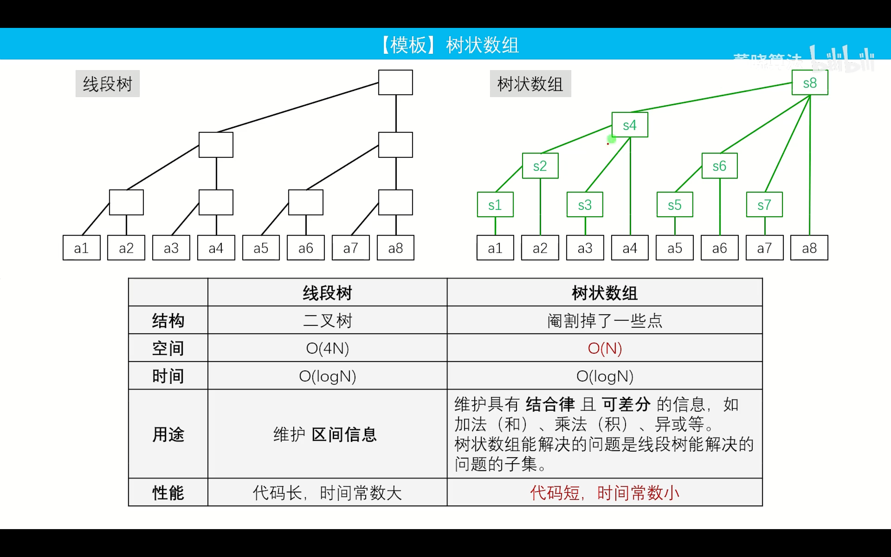
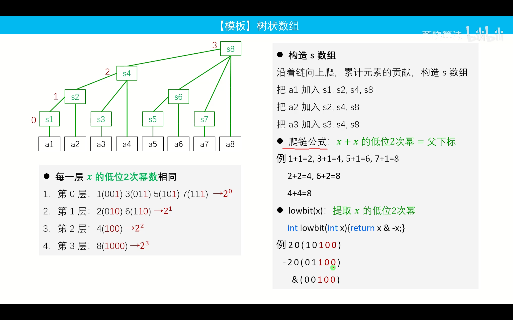
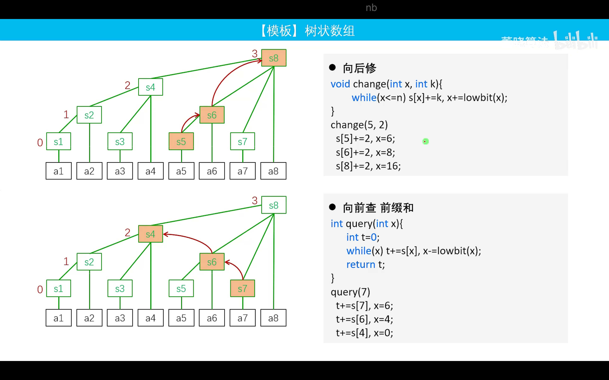
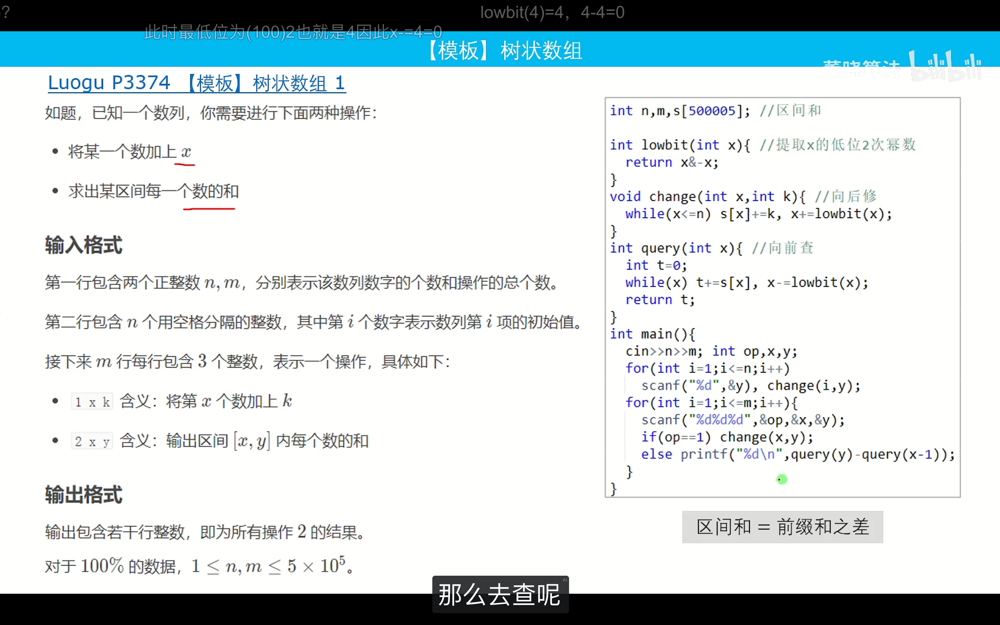
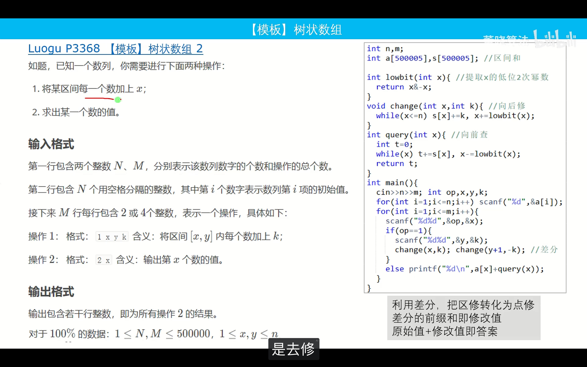

# 树状数组 (Fenwick Tree / BIT)

**用途**：单点修改 + 区间求和（以及它们的对偶），用线段树太重的场景。

**时间复杂度**：修改 $O(\log n)$，查询 $O(\log n)$，空间 $O(n)$。

---

## 核心思想

线段树管一段区间，树状数组管一个**前缀**。每个节点 $s[x]$ 存的是 $[x - \text{lowbit}(x) + 1,\ x]$ 这**一段**的和。



查询前缀和 $[1, x]$ 时，不断剥掉最低位的 1：

$$x \to x - \text{lowbit}(x)$$

所有经过的 $s[x]$ 加起来就是结果。



修改时，更新 $x$ 后，需要把**所有覆盖了 $x$ 的区间**都更新：

$$x \to x + \text{lowbit}(x)$$



---

## lowbit

```cpp
int lowbit(int x) { return x & -x; }
```

`lowbit(x)` 取出 $x$ 二进制最低位的 1 所代表的值。

| x | 二进制 | lowbit(x) |
|---|--------|-----------|
| 1 | 0001   | 1 |
| 2 | 0010   | 2 |
| 3 | 0011   | 1 |
| 4 | 0100   | 4 |
| 5 | 0101   | 1 |
| 6 | 0110   | 2 |
| 7 | 0111   | 1 |
| 8 | 1000   | 8 |

规律：$x$ 能被 $2^k$ 整除但不能被 $2^{k+1}$ 整除，则 $\text{lowbit}(x) = 2^k$。

设 $s[x] = \sum a[x - \text{lowbit}(x) + 1\ ..\ x]$，那么：

- $s[6] = a[5] + a[6]$（管 2 个）
- $s[8] = a[1] + \dots + a[8]$（管 8 个）
- $s[4] = a[1] + a[2] + a[3] + a[4]$（管 4 个）

---

## 为什么下标必须从 1 开始

`lowbit(0) = 0 & -0 = 0`，一旦 `x` 变成 0：

```cpp
while (x >= 1) x -= lowbit(x);  // lowbit(0) = 0 → x 永远不动 → 死循环
```

所以 BIT 必须 **1-indexed**。数据是 0-index 的话整体 `+1` 映射：

```cpp
for (int i = 0; i < n; i++)
    update(i + 1, a[i]);              // 原下标 i → BIT 下标 i+1
int ans = query(r + 1) - query(l);    // query(l) 不含 a[l]，但原 l 已 +1
```

---

## 模板 1：单点修改 + 区间查询（P3374）



```cpp
int n, s[N];  // s 是树状数组

int lowbit(int x) { return x & -x; }

// 位置 x 加上 k
void update(int x, int k) {
    while (x <= n) s[x] += k, x += lowbit(x);
}

// 前缀和 [1, x]
int query(int x) {
    int r = 0;
    while (x >= 1) r += s[x], x -= lowbit(x);
    return r;
}

// 区间和 [l, r]
int range_sum(int l, int r) {
    return query(r) - query(l - 1);
}
```

**建树**：直接对每个位置 `update(i, a[i])`，$O(n \log n)$；或者用前缀和线性建树：

```cpp
// O(n) 建树
for (int i = 1; i <= n; i++) {
    s[i] += a[i];
    int j = i + lowbit(i);
    if (j <= n) s[j] += s[i];
}
```

---

## 模板 2：区间修改 + 单点查询（P3368）

用**差分数组** $d[i] = a[i] - a[i-1]$ 把区间修改转成两个单点修改：

$$a[l..r] + k \iff d[l] \mathrel{+}= k,\quad d[r+1] \mathrel{-}= k$$

单点查询就是差分数组的前缀和：$a[x] = \sum_{i=1}^x d[i]$

所以直接用 BIT 维护差分数组即可。

```cpp
int n, s[N];

int lowbit(int x) { return x & -x; }

void update(int x, int k) {
    while (x <= n) s[x] += k, x += lowbit(x);
}

int query(int x) {       // 单点查询 = 差分前缀和
    int r = 0;
    while (x >= 1) r += s[x], x -= lowbit(x);
    return r;
}

// 区间加 [l, r] + k
void range_add(int l, int r, int k) {
    update(l, k);
    update(r + 1, -k);
}
```

---

## 模板 3：区间修改 + 区间查询（双 BIT）

### 推导

设 BIT 维护差分数组 $d[i] = a[i] - a[i-1]$，则 $a[x] = \sum_{i=1}^x d[i]$。

区间加 $[l,r] + k$ 只需两次单点修改：

$$d[l] \mathrel{+}= k, \quad d[r+1] \mathrel{-}= k$$

现在要求区间和 $\text{pre}(x) = \sum_{i=1}^x a[i]$。把 $a[i]$ 用 $d$ 展开：

$$\text{pre}(x) = \sum_{i=1}^x a[i] = \sum_{i=1}^x \sum_{j=1}^i d[j]$$

交换求和顺序：$d[j]$ 会被所有 $i \in [j, x]$ 累加，每个区间长度 = $x - j + 1$：

$$\text{pre}(x) = \sum_{j=1}^x d[j] \cdot (x - j + 1)$$

拆开：

$$\text{pre}(x) = (x+1)\underbrace{\sum_{j=1}^x d[j]}_{S_1} - \underbrace{\sum_{j=1}^x j \cdot d[j]}_{S_2}$$

**结论**：需要两个 BIT 分别维护：

| BIT | 存的量 | 提供 |
|-----|--------|------|
| `t1` | $d[i]$ | $S_1$ |
| `t2` | $i \cdot d[i]$ | $S_2$ |

### 区间加 $[l,r] + k$ 时两个 BIT 的更新

| 位置 | $d$ 变化 | `t1` 变化 | `t2` 变化（$i \cdot d[i]$） |
|------|----------|-----------|---------------------------|
| $l$ | $+k$ | $+k$ | $+ k \cdot l$ |
| $r+1$ | $-k$ | $-k$ | $- k \cdot (r+1)$ |

### 代码

```cpp
ll t1[N], t2[N];

int lowbit(int x) { return x & -x; }

// 差分点 pos 加 k，更新两个 BIT
// 注意 t2 乘的是 pos（原始位置，不变的），不是 BIT 遍历下标 i
void add(int pos, ll k) {
    for (int i = pos; i <= n; i += lowbit(i))
        t1[i] += k, t2[i] += k * pos;
}

// 求前缀和 pre(x) = sum a[1..x]
ll query(int x) {
    ll s1 = 0, s2 = 0;
    for (int i = x; i >= 1; i -= lowbit(i))
        s1 += t1[i], s2 += t2[i];
    return (x + 1) * s1 - s2;
}

// 区间加 [l, r] + k
void range_add(int l, int r, ll k) {
    add(l, k), add(r + 1, -k);
}

// 区间和 [l, r]
ll range_sum(int l, int r) {
    return query(r) - query(l - 1);
}
```

### 例子

建树 $a = [3, 1, 4, 1, 5]$（每个位置用 `range_add(i, i, a[i])`）：

最终差分 $d = [3, -2, 3, -3, 4]$。

求 $\text{pre}(3)$：
```cpp
S1 = d[1]+d[2]+d[3] = 3 + (-2) + 3 = 4
S2 = 1·3 + 2·(-2) + 3·3 = 3 - 4 + 9 = 8
pre(3) = (3+1)·4 - 8 = 8   // = 3+1+4 ✓
```

区间加 $[2,4] + 2$（`range_add(2, 4, 2)`）：差分变为 $d = [3, 0, 3, -3, 2]$。

```cpp
新 pre(3) = (3+1)·(3+0+3) - (3+0+9) = 24-12 = 12   // = 3+3+6 ✓
```

---

## 树状数组 vs 线段树

| | 树状数组 | 线段树 |
|---|---------|--------|
| 空间 | $n + 2$ | $4n$ |
| 常数 | 极小 | 较大 |
| 代码量 | ~10 行 | ~40 行 |
| 单点修改 + 区间和 | ✅ | ✅ |
| 区间修改 + 区间和 | ✅（双 BIT） | ✅ |
| 区间最值 | ❌ | ✅ |
| 可持久化 | ❌ | ✅ |
| 第 k 大（权值 BIT） | ✅ | ✅ |
| 二维扩展 | ✅ | ✅ |

**原则**：能用 BIT 就用 BIT，必须线段树才上线段树。

---

## 习题

| 题目 | 知识点 |
|------|--------|
| P3374 树状数组 1 | 单点修改 + 区间查询 |
| P3368 树状数组 2 | 区间修改 + 单点查询（差分） |
| P1908 逆序对 | 权值 BIT 统计 |
| P10589 楼兰图腾 | 前后缀计数 + BIT |
| P2068 统计和 | BIT 裸题 |
| P1198 最大数 | BIT 反向 / 线段树 |
